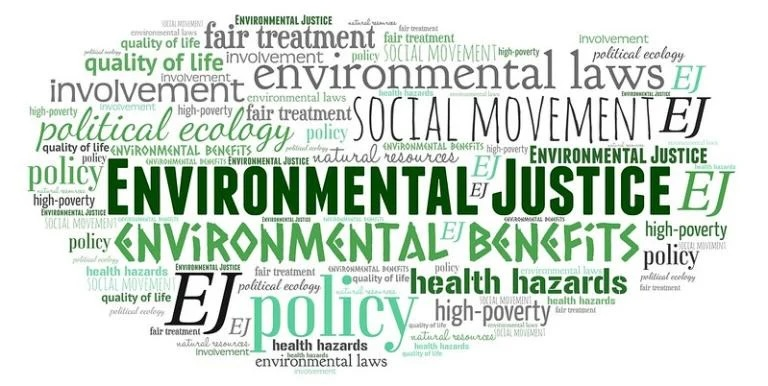

# EDS223 Homework Assignmnet 2: Exploring patterns of environmental justice

<p align="center">
  
</p>

This repository contains the materials for the [second homework assignment](https://eds-223-geospatial.github.io/assignments/HW2V2.html) for [EDS 223: Geospatial Analysis and Remote Sensing](https://bren.ucsb.edu/courses/eds-223), a course that is part of the Master of Environmental Data Science program completed at the Bren School of Environmental Science and Management.

The homework assignment focuses on historical racial injustices in the U.S based on redlining and pedestrian safety. Currently, there are still present day impact on the environments the communities reside in that were redlined during the 1930's Home Owners' Loan Corporation where they graded neighborhoods that made homeownership loans inaccessible. Beyond that, there is also a current safety hazard regarding pedestrians in the affected neighborhoods, which stem from poorly designed roadways, badly maintained sidewalks, and unregulated speeding that increase death.

## Folder Organization

The **folders** are organized as the following:

```
EDS223-HWK2
├── data
│   └── ejscreen
├── image
│   └── image-ej.jpeg
└── README.md
```

Inside the main **data** folder, there is a folder titled **ejscreen**. Inside that folder, there is a technical documnetation called **ejscreen-tech-doc-version-2-2.pdf** that describes the datasheet with detailed information on how it is structured regarding the data and then a column description called **EJSCREEN_2023_BG_Columns.xlsx**. Continuing inside the **data** folder, there is another folder titled **mapping-inequality** with a the date file **mapping-inequality-los-angeles.json**.


## Contributer
The author for this homework assisgnment is Monique Hernandez.

## Important Notice

The data used for this assignment comes from the Environmental Justice Screening and Mapping Tool, despite it no longer in operation there is still aan unofficial version of it [here](https://pedp-ejscreen.azurewebsites.net/).

## References

"EJScreen Technical Documentation", U.S. Environmental Protection Agency (EPA), 2022.[Accessed: Oct. 19, 2026]

Taylor, N. L., Porter, J. M., Bryan, S., Harmon, K. J., & Sandt, L. S. (2023). "Structural racism and pedestrian safety: Measuring the association between historical redlining and contemporary pedestrian fatalities across the United States", 2010–2019. American Journal of Public Health, 113. [Accessed: Oct. 19, 2026]

Gee, G. C. (2008). A multilevel analysis of the relationship between institutional and individual racial discrimination and health status. American journal of public health, 98(Supplement_1), S48-S56.

Nardone, A., Rudolph, K. E., Morello-Frosch, R., & Casey, J. A. (2021). Redlines and greenspace: the relationship between historical redlining and 2010 greenspace across the United States. Environmental health perspectives, 129(1), 017006.

Hoffman, J. S., Shandas, V., & Pendleton, N. (2020). The effects of historical housing policies on resident exposure to intra-urban heat: a study of 108 US urban areas. Climate, 8(1), 12.

Taylor, N. L., Porter, J. M., Bryan, S., Harmon, K. J., & Sandt, L. S. (2023). Structural racism and pedestrian safety: Measuring the association between historical redlining and contemporary pedestrian fatalities across the United States, 2010–2019. American Journal of Public Health, 113(4).

Robert K. Nelson, LaDale Winling, Richard Marciano, Nathan Connolly, et al., “Mapping Inequality,” American Panorama, ed. Robert K. Nelson and Edward L. Ayers, accessed October 17, 2023, https://dsl.richmond.edu/panorama/redlining/↩︎